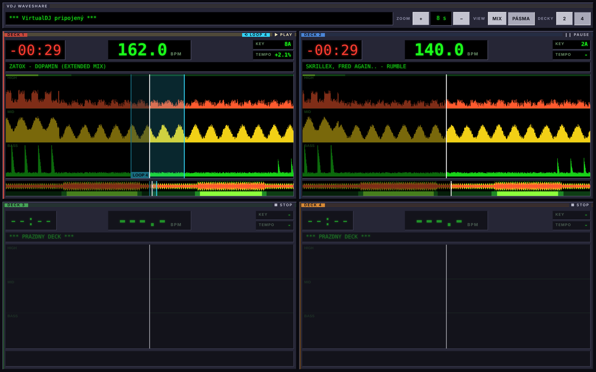

# VDJ WaveShare

Live VirtualDJ waveforms for your lighting operator. Open a browser on any device in the same network and see what the DJ plays: waveform, BPM, time left, loops and energy, for up to 4 decks.

Works with streaming (TIDAL), since the plugin reads the decoded audio inside VirtualDJ. No files, no audio leaves the DJ laptop.



<sub>Screenshot with simulated data.</sub>

## Features

- 3-band waveform (bass, mids, highs), 100 columns per second
- Zoom from 2 to 64 seconds, by buttons, mouse wheel or pinch
- Two views: MIX (bands overlaid) and PÁSMA (bands in separate lanes)
- Energy strip: dark for breakdowns, bright green for drops
- BPM as the largest number in the deck color, plus key, tempo and time left
- Beat lines synced with the VirtualDJ beat grid, bars brighter
- Loop region with length in beats
- 2 or 4 decks, colored like VirtualDJ: red, blue, green, orange
- Pre-load: a track on a paused deck gets scanned while another deck plays
- Phone, tablet and desktop layouts, made for touch: pinch zoom, double tap reset, full screen
- Cable first: uses the Ethernet cable when it is plugged in, Wi-Fi when not
- No cloud, no accounts, no npm packages

## Requirements

| Part | Needs |
| --- | --- |
| DJ laptop | macOS on Apple Silicon or Intel, VirtualDJ 8 / 2021+, Xcode Command Line Tools (`xcode-select --install`), Node.js 18+ |
| Lighting operator | Any modern browser in the same network |

Windows is not supported yet. See [Contributing](CONTRIBUTING.md).

## Quick start

On the DJ laptop:

```sh
git clone https://github.com/kebab-py/vdj-waveshare.git
cd vdj-waveshare

# 1. Close VirtualDJ, then build and install the plugin
plugin/build.sh

# 2. Start the server
node server/server.js
```

3. Open VirtualDJ. In the effect list of deck 1 and deck 2, switch on WaveShare.
4. The server prints addresses like `http://192.168.1.20:7777`. Open one on the lighting operator's device.

Keep the server window open during the set. Close VirtualDJ before you stop the server.

## Cable or Wi-Fi

By default the server uses the cable when it is connected and Wi-Fi when it is not. It checks every 2 seconds and switches on its own when you plug the cable in or pull it out. The console and `server/server.log` print the new address, and the dashboard status shows `KÁBEL` or `WI-FI`.

Cable setup: connect the DJ laptop and the lighting PC or tablet with an Ethernet cable (USB or Thunderbolt adapter on the Mac). Both sides get a `169.254.x.x` address on their own, no router needed. Open the cable address on the lighting device.

A switch drops browsers on the old link. Open the new address shown in the console.

```sh
node server/server.js --list          # adapters: en0 Wi-Fi, en5 cable (USB 10/100/1000 LAN), ...
node server/server.js                 # auto: cable, else Wi-Fi
node server/server.js --iface en5     # only this adapter, waits until it has an address
node server/server.js --iface all     # every adapter at once
```

`--iface` takes the adapter name, its IP or part of the port name (`--iface usb`). Set `iface` in `CONFIG` in `server.js` to make it permanent.

On the tablet: open the address, tap the full screen button, set auto-lock to never.

## How it works

```
VirtualDJ ─ WaveShare plugin ─▶ UDP :7778 ─▶ server.js ─▶ HTTP/SSE :7777 ─▶ browsers
```

- [Architecture](docs/architecture.md): plugin, server, dashboard, known issues
- [Protocol](docs/protocol.md): UDP packets and HTTP routes

## Development

```
plugin/   WaveShare.cpp (VirtualDJ plugin, C++17), build and test scripts
server/   server.js (Node, no dependencies) and index.html (dashboard, single file)
tools/    simulate.js: plays audio files as fake decks. udp-test.js: prints raw plugin output
docs/     docs and the project landing page (GitHub Pages)
```

| Task | Command |
| --- | --- |
| Test plugin logic without VirtualDJ | `plugin/test.sh` |
| Build without installing | `plugin/build.sh --no-install` |
| Test server and dashboard without VirtualDJ | `node tools/simulate.js --demo` or `node tools/simulate.js a.mp3 b.wav` |
| Inspect plugin output | `node tools/udp-test.js` (server stopped) |
| Check VirtualDJ script queries | `node server/server.js --test "get_bpm"` (needs Network Control) |

Debugging: `server/server.log` lists track changes, finished waveforms, pre-load results and plugin silence. macOS crash reports for VirtualDJ live in `~/Library/Logs/DiagnosticReports`.

Every pull request runs a macOS build and the plugin test in GitHub Actions.

## Contributing

Read [CONTRIBUTING.md](CONTRIBUTING.md). Open an issue before large changes.

## License

[GPL-3.0](LICENSE). The VirtualDJ SDK headers belong to Atomix Productions and are not part of this repo. `plugin/fetch-sdk.sh` downloads them from virtualdj.com.

Not affiliated with Atomix Productions or VirtualDJ.
